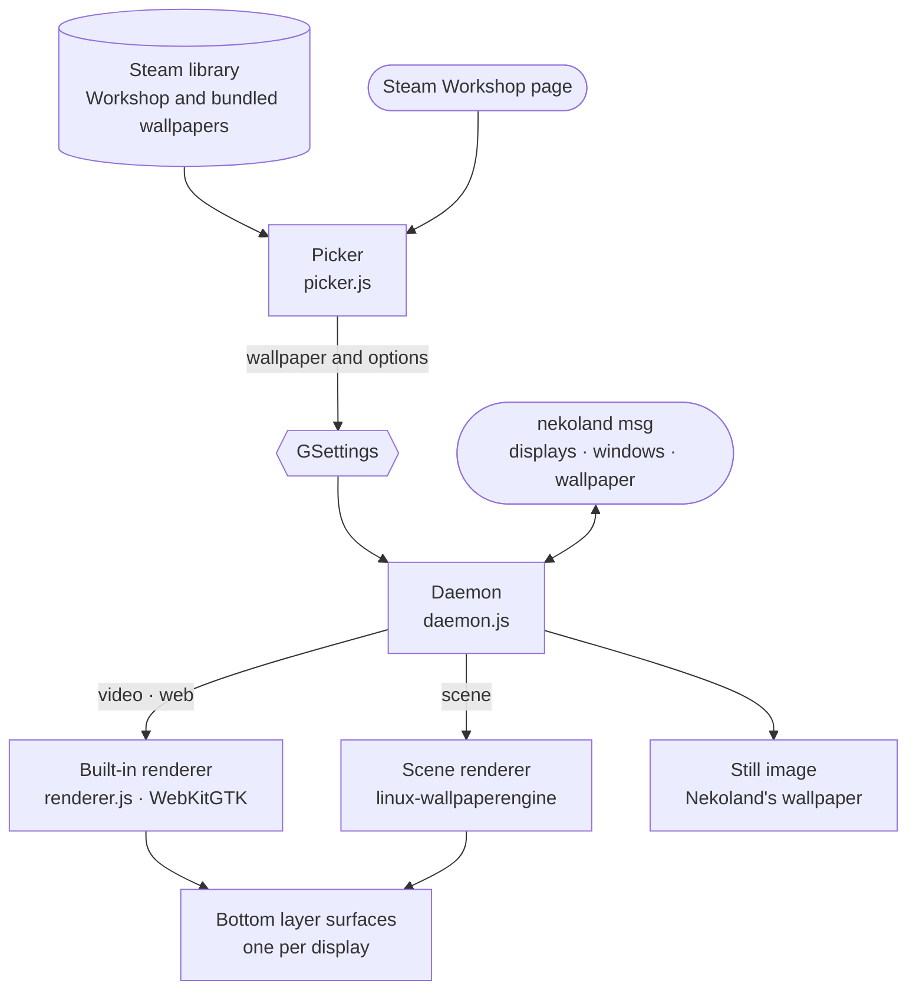

<p align="center">
  
</p>

<h1 align="center">Paper Engine for Nekoland</h1>

<p align="center">
  <strong>Your Wallpaper Engine library, live on the Nekoland desktop.</strong><br>
  Video, web and scene wallpapers from your Steam copy of
  <a href="https://store.steampowered.com/app/431960/Wallpaper_Engine/">Wallpaper Engine</a>
  as the desktop of <a href="https://github.com/KoukeNeko/Nekoland">Nekoland</a>,
  with a picker that also browses the Steam Workshop.
</p>

It is a daemon that plays the wallpaper and a picker to choose it. It needs a
Wallpaper Engine licence on Steam — the wallpapers and the scene assets come
from your own Steam library; nothing is bundled here.

## What works

| Wallpaper type | Rendered by | Status |
| --- | --- | --- |
| Video | built-in renderer (WebKitGTK + GStreamer) | works out of the box |
| Web | built-in renderer (WebKitGTK) | works out of the box; user properties and audio-reactive data supported |
| Scene | [linux-wallpaperengine](https://github.com/Almamu/linux-wallpaperengine), patched | one click to install from the picker; most 2D scenes work, with scripts, text, clicks and media displays |
| Application | — | not supported (Windows executables) |

## Requirements

- Nekoland, on Ubuntu (developed on Ubuntu 26.10).
- Steam, with Wallpaper Engine owned.

`install.sh` installs what it runs with when missing, with `sudo apt-get`:
GJS, WebKitGTK, libadwaita and gtk-layer-shell's bindings, GStreamer's
PulseAudio source and WirePlumber. Building the scene renderer needs `git`,
`cmake`, `ninja-build` and `g++`.

## Install

From a checkout, as the user who uses Nekoland, inside Nekoland:

```bash
./install.sh
```

It puts the program in `~/.local/share/nekoland-paper-engine/app`, adds
**Paper Engine** to the launcher, adds the daemon to Nekoland's `autostart` and
starts it. Run it again to update. Run outside Nekoland, it says what to add
to `autostart` in `~/.config/nekoland/config.toml` instead.

### Getting wallpapers

1. In Steam, enable *Settings → Compatibility → Enable Steam Play for all other
   titles*, then install Wallpaper Engine (it is a Windows application; it only
   has to be installed, not run).
2. Subscribe to wallpapers in the
   [Workshop](https://steamcommunity.com/app/431960/workshop/). Steam downloads
   them to `steamapps/workshop/content/431960`, which the picker scans, along
   with the projects that ship with Wallpaper Engine.

You can also add your own folders of wallpaper projects under
*Playback and performance → Other wallpaper folders*.

### Scene wallpapers

Scene wallpapers need a renderer that is built once per user. Press
**Install** on the bar that appears above the wallpapers in the picker; it
asks first, then runs in the background, and the scenes become available
when it is done. If it fails, the bar offers the log. From a terminal,
`./setup-scene-renderer.sh` does the same.

It builds linux-wallpaperengine into `~/.local/share/nekoland-paper-engine`
without root: its ~100 build dependencies are downloaded and unpacked there
rather than installed, because installing them system-wide would swap out
JACK libraries that Steam uses. It downloads roughly 1 GB and takes a few
minutes. The bar offers **Update** when a newer version of this project
changes the patches the renderer is built with. After a distribution upgrade,
build it again.

`patches/` holds fixes this project applies on top of linux-wallpaperengine so
puppet-warp layers (animated characters) are drawn, scene scripts run, and
text layers and media displays work; characters are shown in their rest pose,
since that renderer does not play bone animations.

Scenes also need Wallpaper Engine's `assets` folder. It is used from a
Wallpaper Engine install in any Steam library. Without one, the bar offers
**Download** instead: the picker asks for the Steam account name, then for
the password and Steam Guard code when Steam wants them, and uses
[SteamCMD](https://developer.valvesoftware.com/wiki/SteamCMD) to download
Wallpaper Engine's Windows depot (about 800 MB). Only its `assets` folder is
kept, in `~/.local/share/nekoland-paper-engine/assets`. SteamCMD is kept in
`~/.local/share/nekoland-paper-engine/steamcmd` with its own sign-in, separate
from the Steam client's; it is a 32-bit program, so it needs the i386
libraries that Steam also uses. The settings show the account it stays signed
in as and can sign it out, which keeps the downloaded assets.

Scenes that use a 3D perspective camera are not supported by
linux-wallpaperengine yet. The picker marks those it can recognise as
*Not supported*; for any other scene whose renderer keeps crashing, the
daemon says so and stops retrying.

## Using it

The picker has three panes. It is available in English and Traditional
Chinese; it follows the system language unless you pick one under
*Playback and performance → Language*.

- **Sidebar** – your library by type, the Steam Workshop (trending, newest,
  most subscribed, and what you are subscribed to), playback settings, and the
  wallpaper that is playing with pause / mute / stop.
- **Grid** – click a wallpaper to see its details, double-click to apply it.
- **Details** – preview, the apply button, and the options the wallpaper
  exposes (colours, sliders, toggles, …).

Workshop browsing reads Steam's public Workshop page, which is not a stable
interface and may break when Steam changes it. Subscribing happens in Steam:
the picker opens the wallpaper's page in the Steam client, and it appears in
the library once Steam has downloaded it.

*Playback and performance → Playback rules* decide what playback does while a
window is on screen, while every display is covered by a window that fills
most of it (maximized) or all of it (fullscreen), while another application
plays audio, and while on battery power: keep running, mute, pause, or stop,
which ends the renderer and frees the memory it holds. When several apply,
the strongest wins. By default playback pauses under maximized and fullscreen
windows. Nekoland tells nobody when its windows change, so the daemon asks it
once a second, and only while a window rule is set.

*Playback and performance → Quality* limits the frame rate of scene and web
wallpapers (video plays at its own), and for scenes sets the resolution they
are rendered at (100, 75 or 50%) and whether their particles are drawn. On a
computer with more than one graphics card it also chooses the card the
wallpaper is rendered on.

With several displays, a wallpaper can be applied to all of them or to one.
Wallpapers added to the playlist can rotate on a timer
(*Playback and performance → Playlist*).

A still of the wallpaper becomes Nekoland's own `wallpaper`, so that is what
shows on the lock screen, in the overview's desktops, before the wallpaper
starts, and what the menu bar takes its text colour from; the previous
wallpaper comes back when the wallpaper is stopped
(*Playback and performance → Still image as Nekoland wallpaper*).

The wallpaper gets the pointer where no window is, so wallpapers
react to it and to clicks as far as their renderer supports it.

Web wallpapers are Workshop content, so each one is confined to the files of
its own folder; it cannot read anything else on the computer. Those that
visualise audio get the spectrum of whatever the system is playing; it is only
captured while such a wallpaper is running.

## How it works

The renderers draw wlr-layer-shell surfaces on the bottom layer, one per
display. Nekoland draws that layer under the windows and the desktop's icons
and over the background layer, where its own wallpaper (swaybg) is.



The daemon sends pause, mute and volume to the built-in renderer over its
standard input; it pauses the scene renderer with SIGSTOP and mutes it
through WirePlumber.

- `src/daemon.js` – the daemon: one per session, started from Nekoland's
  `autostart` and by the picker; quits when Nekoland does.
- `src/session.js` – what the daemon reads from `nekoland msg` and `pw-dump`.
- `src/renderer.js` – GTK 3 + WebKitGTK process for video and web
  wallpapers, one layer surface per display, controlled over stdin.
- `src/picker.js` – the picker and settings window.
- `src/library.js` – finds Steam libraries, reads `project.json`, lists the
  graphics cards through switcheroo-control, and loads the settings.
- `src/workshop.js` – reads the Steam Workshop browse page.
- `src/sceneAssets.js` – downloads the scene assets with SteamCMD.
- `src/conditions.js` – evaluates when a wallpaper option is shown.
- `install.sh`, `uninstall.sh` – the install and its removal.
- `setup-scene-renderer.sh`, `patches/` – builds the patched scene renderer.
- `tests/run.js` – tests for the parsers that read outside content
  (`gjs -m tests/run.js`).
- `po/` – translations; `zh_TW.po` is the only one so far.

## Uninstall

```bash
./uninstall.sh
```

Nekoland's wallpaper goes back to the one the still replaced. The scene
renderer, any downloaded scene assets and SteamCMD with its saved Steam
sign-in stay in your home folder. To remove them as well, and the still image:

```bash
./uninstall.sh --all
```

## Licence

GPL-3.0-or-later. Not affiliated with Wallpaper Engine or Valve.
