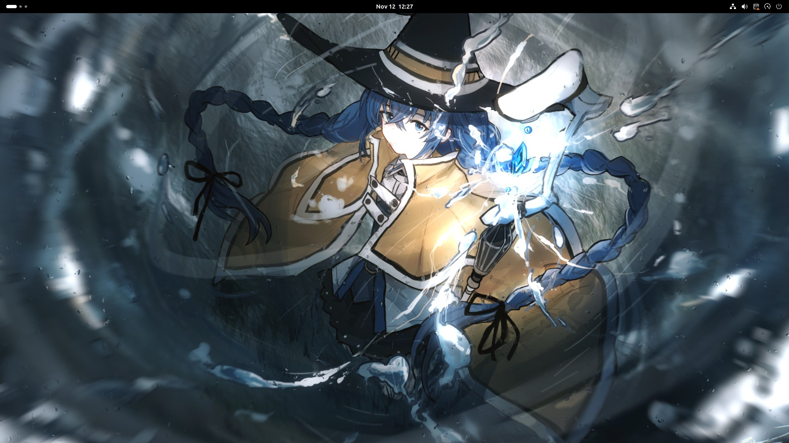
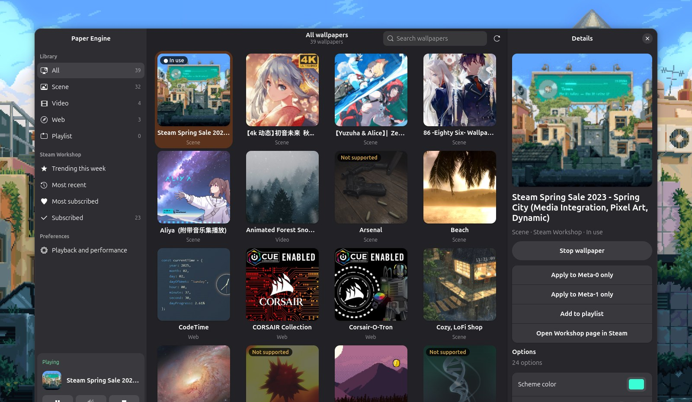
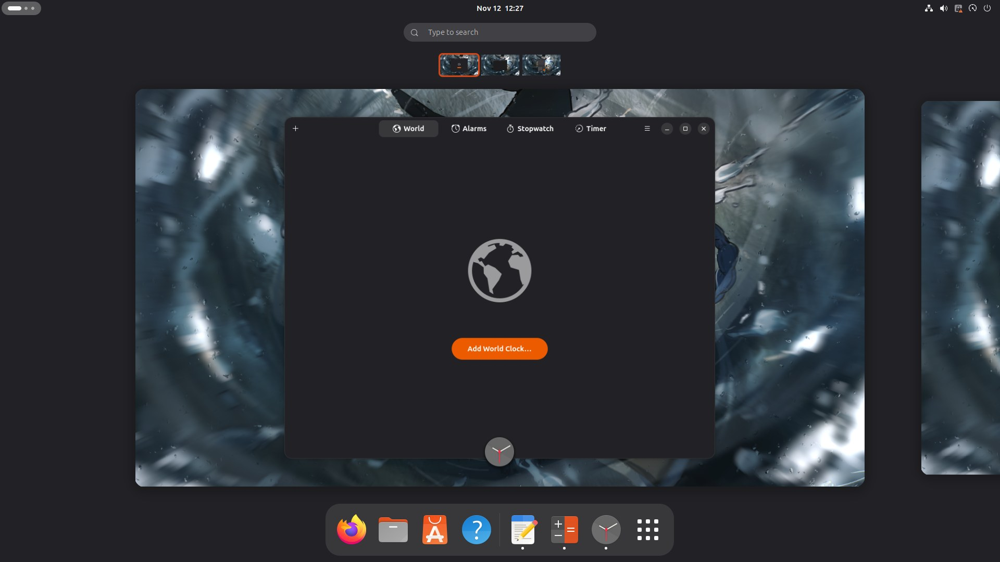
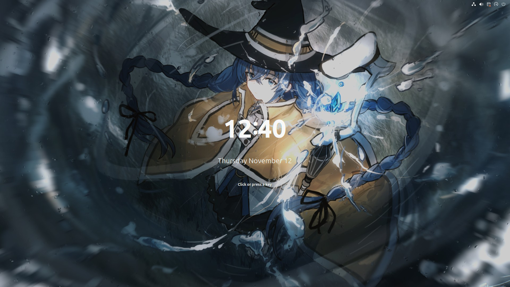
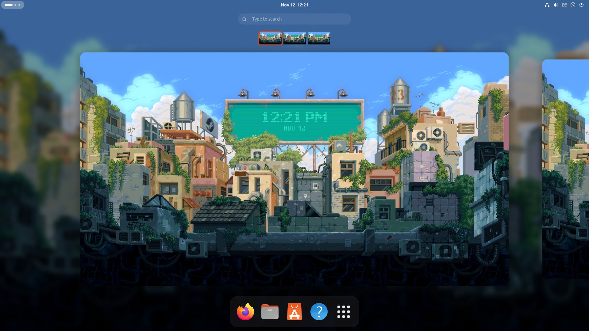
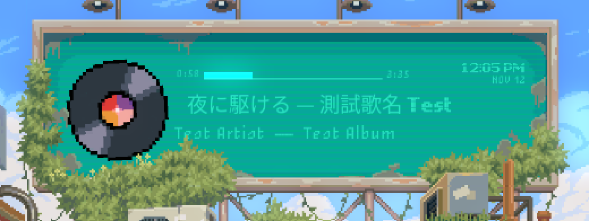

<p align="center">
  
</p>

<h1 align="center">GNOME Paper Engine</h1>

<p align="center">
  <strong>Your Wallpaper Engine library, live on the GNOME desktop.</strong><br>
  Video, web and scene wallpapers from your Steam copy of
  <a href="https://store.steampowered.com/app/431960/Wallpaper_Engine/">Wallpaper Engine</a>
  as the desktop background on Ubuntu / GNOME (Wayland), with a picker that
  also browses the Steam Workshop.
</p>

<p align="center">
  
  
  
  <a href="https://github.com/KoukeNeko/GNOME-Paper-Engine/actions/workflows/build.yml"></a>
  <a href="LICENSE"></a>
  <a href="https://github.com/KoukeNeko/GNOME-Paper-Engine/stargazers"></a>
</p>

<p align="center">
  <a href="#install"><strong>Install</strong></a>
  · <a href="#see-it-in-action">See it in action</a>
  · <a href="#what-works">What works</a>
  · <a href="#using-it">Using it</a>
  · <a href="#how-it-works">How it works</a>
</p>

It is a GNOME Shell extension with a wallpaper picker. It needs a Wallpaper
Engine licence on Steam — the wallpapers and the scene assets come from your
own Steam library; nothing is bundled here.

## See it in action

<p align="center">
  
</p>

<p align="center">
  
</p>

<p align="center">
  
</p>

<p align="center">
  
</p>

| The overview and its workspace thumbnails show the wallpaper | A scene's media display, fed by the player that is running |
| --- | --- |
|  |  |

<p align="center"><sub>
  The wallpapers and thumbnails in these screenshots are Steam Workshop
  content. They are the work of their respective authors, who hold the
  copyright; they are shown here only to illustrate the software and are not
  part of this project or covered by its licence.
</sub></p>

## What works

| Wallpaper type | Rendered by | Status |
| --- | --- | --- |
| Video | built-in renderer (WebKitGTK + GStreamer) | works out of the box |
| Web | built-in renderer (WebKitGTK) | works out of the box; user properties and audio-reactive data supported |
| Scene | [linux-wallpaperengine](https://github.com/Almamu/linux-wallpaperengine), patched | one click to install from the picker; most 2D scenes work, with scripts, text, clicks and media displays |
| Application | — | not supported (Windows executables) |

## Requirements

- Ubuntu with GNOME Shell 51 on Wayland (developed on Ubuntu 26.10).
- Steam, with Wallpaper Engine owned.

No extra packages are needed for video and web wallpapers. Building the
scene renderer needs `git`, `cmake`, `ninja-build` and `g++`, which the
package recommends.

## Install

### As a .deb package

Download the latest development build from the
[dev release](https://github.com/KoukeNeko/GNOME-Paper-Engine/releases/tag/dev),
or build it yourself with `./build-deb.sh` (it ends up in `dist/`), then:

```bash
sudo apt install ./gnome-paper-engine_*_all.deb
```

Log out and back in, then turn the extension on once:

```bash
gnome-extensions enable gnome-paper-engine@koukeneko.github.io
```

Open **Paper Engine** from the app grid. To remove it again:

```bash
sudo apt remove gnome-paper-engine
```

### From the source folder, without root

```bash
./install.sh
```

Log out and back in once (a running GNOME Shell only discovers new extensions
at login), then open **Paper Engine** from the app grid. A copy installed
this way takes precedence over the package, so use one or the other.

### Getting wallpapers

1. In Steam, enable *Settings → Compatibility → Enable Steam Play for all other
   titles*, then install Wallpaper Engine (it is a Windows application; it only
   has to be installed, not run).
2. Subscribe to wallpapers in the
   [Workshop](https://steamcommunity.com/app/431960/workshop/). Steam downloads
   them to `steamapps/workshop/content/431960`, which the picker scans, along
   with the projects that ship with Wallpaper Engine.

You can also add your own folders of wallpaper projects under
*Playback and performance → Other wallpaper folders*.

### Scene wallpapers

Scene wallpapers need a renderer that is built once per user. Press
**Install** on the bar that appears above the wallpapers in the picker; it
asks first, then runs in the background, and the scenes become available
when it is done. If it fails, the bar offers the log.

It builds linux-wallpaperengine into `~/.local/share/gnome-paper-engine`
without root: its ~100 build dependencies are downloaded and unpacked there
rather than installed, because installing them system-wide would swap out
JACK libraries that Steam uses. It downloads roughly 1 GB and takes a few
minutes. Do it again after a distribution upgrade; delete the directory to
remove it.

<details>
<summary>From a terminal instead</summary>

```bash
gnome-paper-engine-setup-scene   # installed from the .deb
./setup-scene-renderer.sh        # from the source folder
```

</details>

`patches/` holds fixes this project applies on top of linux-wallpaperengine so
puppet-warp layers (animated characters) are drawn, scene scripts run, and
text layers and media displays work; characters are shown in their rest pose,
since that renderer does not play bone animations.

Scenes that use a 3D perspective camera (a few of the samples bundled with
Wallpaper Engine, e.g. *Neon Sunset*) are not supported by
linux-wallpaperengine yet; the extension reports that the renderer keeps
crashing and stops retrying.

## Using it

The picker has three panes. It is available in English and Traditional
Chinese; it follows the system language unless you pick one under
*Playback and performance → Language*.

- **Sidebar** – your library by type, the Steam Workshop (trending, newest,
  most subscribed, and what you are subscribed to), playback settings, and the
  wallpaper that is playing with pause / mute / stop.
- **Grid** – click a wallpaper to see its details, double-click to apply it.
- **Details** – preview, the apply button, and the options the wallpaper
  exposes (colours, sliders, toggles, …).

Workshop browsing reads Steam's public Workshop page, which is not a stable
interface and may break when Steam changes it. Subscribing happens in Steam:
the picker opens the wallpaper's page in the Steam client, and it appears in
the library once Steam has downloaded it.

By default playback pauses while every monitor is covered by a maximized or
fullscreen window. With several monitors, a wallpaper can be applied to all
of them or to one. Wallpapers added to the playlist can rotate on a timer
(*Playback and performance → Playlist*).

A still of the wallpaper is set as the system's desktop background, so that
is what shows before the wallpaper starts and in anything that reads the
background; the previous background comes back when the wallpaper is stopped
(*Playback and performance → Still image as desktop background*).

Scene wallpapers with a media display show what is playing in any MPRIS
player (title, artist, position, and the cover when the player hands it over
as a local file).

With [Blur my Shell](https://github.com/aunetx/blur-my-shell) installed, its
blur of the Dock and the top bar can be switched between the wallpaper alone
and everything behind them from the same settings page.

Web wallpapers are Workshop content, so each one is confined to the files of
its own folder; it cannot read anything else on the computer.

Web wallpapers that visualise audio get the spectrum of whatever the system
is playing; it is only captured while such a wallpaper is running.

The wallpaper never receives input itself, so the extension forwards the
pointer position and left clicks that start on the desktop; wallpapers react
to those as far as their renderer supports it. Behind the lock screen the
wallpaper keeps playing, slightly dimmed (this can be turned off). It is also
the background of the workspaces and their thumbnails in the Activities
overview, and it replaces the system background wherever the shell or an
extension such as Blur my Shell draws a copy of it.

## How it works

`extension/extension.js` starts a renderer process and gives its windows the
`DESKTOP` window type, so Mutter keeps them below every other window, on all
workspaces, and out of the overview, dock and Alt-Tab — the same technique the
Desktop Icons extension uses, and the wallpaper sits below its icons.

- `extension/renderer.js` – GTK 3 + WebKitGTK process for video and web
  wallpapers, one window per monitor, controlled over stdin.
- `extension/library.js` – finds Steam libraries and reads `project.json`.
- `extension/prefs.js` – the picker and settings window.
- `extension/workshop.js` – reads the Steam Workshop browse page.
- `extension/conditions.js` – evaluates when a wallpaper option is shown.
- `extension/backgroundClones.js` – the wallpaper in the overview, its
  thumbnails and wherever else a copy of the system background is drawn.
- `extension/roundedClip.js` – the rounded clip of the wallpaper in the overview.
- `tests/run.js` – tests for the parsers that read outside content
  (`gjs -m tests/run.js`).
- `po/` – translations; `zh_TW.po` is the only one so far.

## Uninstall

The package: `sudo apt remove gnome-paper-engine`.

A source-folder install:

```bash
gnome-extensions disable gnome-paper-engine@koukeneko.github.io
rm -rf ~/.local/share/gnome-shell/extensions/gnome-paper-engine@koukeneko.github.io \
       ~/.local/share/applications/gnome-paper-engine.desktop \
       ~/.local/share/icons/hicolor/scalable/apps/gnome-paper-engine.svg
```

Either way the scene renderer stays in your home folder until you delete it.
The still image used as the desktop background is kept there too, so turn
that option off (or pick another background) first:

```bash
rm -rf ~/.local/share/gnome-paper-engine ~/.cache/gnome-paper-engine
```

## Licence

GPL-3.0-or-later. Not affiliated with Wallpaper Engine or Valve.

The licence covers the code of this project only. The artwork visible in the
screenshots under `docs/` belongs to its original authors on the Steam
Workshop and to the owners of the characters and games it depicts.
